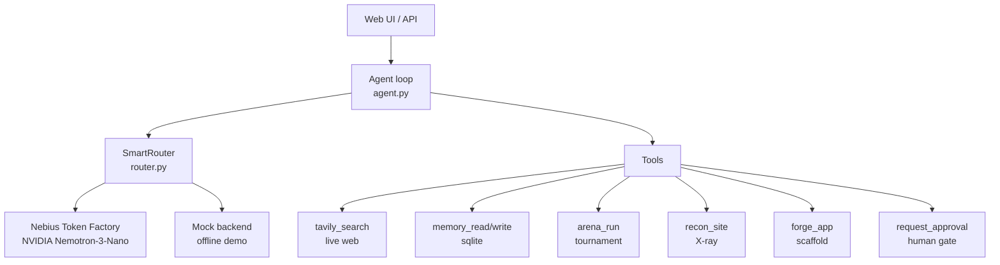

# 🛡️ AEGIS — Autonomous Executive General Intelligence System

[](LICENSE)
[](https://www.python.org/)
[](https://nebius.com)
[](https://nebius.com)
[](#contributing)

**Your always-on personal AI agent — that settles hard calls in an arena,
X-rays any website, and forges apps from plain words.**

AEGIS started as a hackathon entry ([Nebius × NVIDIA Global AI Hackathon](https://nebiusglobalaihackathon.devpost.com),
Personal AI track) and grew into something bigger: one agent that combines
the five ideas currently setting GitHub on fire — multi-agent tournaments,
reverse-engineering recon, free-token smart routing, and describe-it-get-an-app
scaffolding — into a single always-on system.

```bash
git clone https://github.com/yogeshchoudhary555/aegis.git && cd aegis
pip install -r requirements.txt
python app.py          # open http://localhost:8000 — works with zero keys
```

> No API keys? No problem. AEGIS runs in **offline demo mode** out of the box
> (mock backend, same UI, same tool loop). Add `NEBIUS_API_KEY` to `.env` to
> go live on NVIDIA Nemotron via Nebius Token Factory.

## What it does

| Capability | Inspired by | How |
|---|---|---|
| 🧠 Always-on agent loop | — | `agent.py` — plans, calls tools, responds (max 6 steps), asks approval before consequential actions |
| ⚔️ **Arena** — tournament of strategies | [arena-skill](https://github.com/Jakeschincariol/arena-skill) | `arena.py` — N competitors, unique strategy cards, single-elimination debate bracket, judge picks the winner |
| 🔍 **Recon** — reverse-engineer any site | [REA](https://github.com/morluto/rea) | `recon.py` — read-only analysis: what a site does, how features likely work, tech stack, all with cited evidence |
| 🔀 **SmartRouter** — never pay, never fail | [FreeLLMAPI](https://github.com/tashfeenahmed/freellmapi) | `router.py` — ordered providers, automatic failover, per-request usage stats |
| 🏭 **Forge** — describe it, get an app | AI app builders | `forge.py` — LLM designs the project, files written safely to a sandbox |
| 🌐 Live web research | — | `tavily_search` (Tavily API) — the agent sees today's web, not training data |
| 🧠 Persistent memory | — | `memory.py` — sqlite, survives restarts |
| 🎯 Skills | agent skills | `skills/*.md` — reusable prompt-skills, auto-activated |

### The Arena

When an answer has to be *great*, not just first:

```
/arena --agents 8  Should I take the job offer in Bangalore?
```

Eight competitors each get a unique strategy card (reasoning mode × workflow ×
tactic — 2,160 possible cards, dealt without replacement). They pair off:
each attacks the other's solution, defends and revises its own, and a judge
scores every match on a written rubric. 8 → 4 → 2 → 1. What comes back is the
survivor, the attacks it beat, and how many rounds it took.

### Recon

```bash
curl -X POST localhost:8000/api/recon -H 'Content-Type: application/json' \
  -d '{"url": "https://example.com"}'
```

Read-only. Fetches public structure (title, meta, headings, forms, script
hints, headers), guesses the stack from public signals, then has the LLM
explain what the site does and how its features likely work — every claim
labeled with its evidence, guesses marked as guesses. No access controls are
bypassed, ever.

### Forge

```
forge_app: "a habit tracker with streaks, single HTML file"
```

The LLM architects the project (4–10 complete, runnable files — no TODOs),
Forge writes them into `data/forged/<project>/`, safely sandboxed (path
traversal neutralized). You get a manifest: project name, stack, file list.

### SmartRouter

One interface, ordered backends. Live Nebius first; on any failure it fails
over to the next provider instead of crashing your session. Every call is
recorded — see `/api/router-stats` for per-provider calls, success rate,
latency, and failover counts. The app never hard-fails.

## Architecture



## API

| Endpoint | What |
|---|---|
| `GET /` | Single-page UI (chat + briefing + memory + skills) |
| `POST /api/chat` | `{message, history}` → `{reply, tools_used, steps, skill}` |
| `POST /api/arena` | `{task, agents}` → tournament result + champion solution |
| `POST /api/recon` | `{url}` → read-only site analysis |
| `POST /api/forge` | `{description, project_name}` → scaffold manifest |
| `GET /api/router-stats` | provider usage + failover stats |
| `GET /api/briefing` | morning briefing from memory + fresh news |
| `GET /api/memory` / `POST /api/memory` | persistent facts |
| `GET /api/skills` | loaded skills |
| `GET /api/approvals` etc. | human-in-the-loop approval queue |
| `GET /api/health` | provider, model, router stats |

## How we used NVIDIA Nemotron

Every line of agent reasoning runs on **NVIDIA Nemotron-3-Nano-30B-A3B**
(`nvidia/NVIDIA-Nemotron-3-Nano-30B-A3B`). The model drives the full agentic
loop in `agent.py`: it plans which tools to call, issues OpenAI-style function
calls (`tavily_search`, `memory_read`, `memory_write`, `request_approval`,
`arena_run`, `recon_site`, `forge_app`), reads the tool observations, and
composes the final reply. It also powers the Arena's competitors and judges,
Recon's analyst, and Forge's architect — one model, every brain in the
system. Nemotron was chosen because its tool-calling is reliable enough for a
multi-step loop and it is fast and cheap enough to keep an always-on
assistant economical.

## Where Nebius Token Factory accelerated our workflow

- **Zero model hosting.** Token Factory's OpenAI-compatible serverless endpoint
  meant no GPU provisioning, no inference server to babysit — the agent calls
  `https://api.tokenfactory.nebius.com/v1/chat/completions` exactly like an
  OpenAI client (`llm.py`), so the whole build focused on agent behavior, not
  infrastructure.
- **Instant model swap.** The namespaced model ID in one env var
  (`NEMOTRON_MODEL`) let us evaluate Nemotron variants from the Token Factory
  playground and drop the winner straight into the app with no code changes.
- **SmartRouter synergy.** Because the endpoint is serverless and always warm,
  it sits perfectly as the router's primary: fast when live, invisible when
  the mock takes over offline.

## How we used Tavily

The `tavily_search` tool (`tools.py`) fires live Tavily searches inside the
agent loop — the rental-hunt skill pulls current listings the model could
never know from training data, the morning briefing leads with today's news,
and Recon enriches site analysis with public web context. Without Tavily the
pipeline collapses: no live listings, no fresh briefing, no recon context.

## Project structure

```
app.py            FastAPI app + single-page UI + new API routes
agent.py          AEGIS agent loop (tools, approvals, skills)
router.py         SmartRouter: ordered providers, failover, usage stats
arena.py          Tournament engine: strategy deck, bracket, judging rubric
recon.py          Read-only website recon: fetch → structure → LLM analysis
forge.py          App scaffolder: LLM plan → sandboxed file writes
llm.py            NebiusProvider (Nemotron) / MockProvider (offline)
tools.py          Tool specs incl. arena_run, recon_site, forge_app
memory.py         sqlite persistent memory
skills.py         markdown skill loader
skills/           morning-briefing.md, rental-hunt.md, app-forge.md
tests/            smoke tests (no keys needed)
```

## Inspiration & attribution

AEGIS reimplements *ideas* from projects the community is excited about —
all code here is original:

- The tournament concept: [Jakeschincariol/arena-skill](https://github.com/Jakeschincariol/arena-skill) (MIT)
- The reverse-engineering concept: [morluto/rea](https://github.com/morluto/rea) (MIT)
- The free-tier aggregation concept: [tashfeenahmed/freellmapi](https://github.com/tashfeenahmed/freellmapi) (MIT)
- The describe-it-get-an-app concept: the current wave of AI app builders

## Contributing

PRs welcome. Run the smoke tests before pushing:

```bash
python3 tests/test_smoke.py
```

## License

Apache-2.0 — see [LICENSE](LICENSE).
